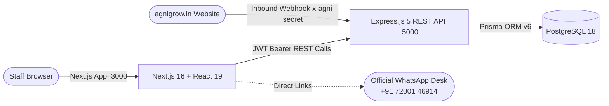

# 🛠️ AgniGrow CRM — Technology Stack Specification

> **Document Version:** 1.0.0  
> **Application:** AgniGrow Back-Office Enterprise CRM  
> **Architecture:** Decoupled Full-Stack Architecture (Standalone Express REST API + Next.js App Router)  
> **Target Audience:** Engineering Team, System Architects, DevOps  

---

## 🏛️ System Architecture Overview



---

## 1. 🚀 Backend Layer (`backend/`) — Port `5000`

The backend is an independent, production-ready Node.js REST API service built with Express 5 and Prisma ORM.

| Category | Technology | Version | Purpose / Implementation |
| :--- | :--- | :--- | :--- |
| **Runtime** | **Node.js** | `v20+ LTS` | Server-side JavaScript runtime with async I/O. |
| **Framework** | **Express.js** | `v5.0` | High-performance routing, middleware pipelines, and HTTP controllers. |
| **Language** | **TypeScript** | `v5.x` | Strict type definitions, end-to-end type safety, and clean OOP architecture. |
| **Execution Engine** | **tsx / ts-node** | Latest | Hot-reloading development runner with instant TypeScript transpile. |
| **Database ORM** | **Prisma ORM** | `v6.19.3` | Relational schema definitions, migrations, automated query building, and type generation. |
| **Database Engine** | **PostgreSQL** | `v18.6` | ACID-compliant relational database. Supports local PostgreSQL, Neon.tech, and Supabase. |
| **Authentication** | **JSON Web Token (`jsonwebtoken`)** | `v9.x` | Stateless HMAC-SHA256 bearer tokens with 7-day expiration. |
| **Password Security**| **bcryptjs** | `v3.x` | Salted SHA-512 password hashing (10 salt rounds) for staff user accounts. |
| **Webhook Security** | **Shared Secret Header** | Custom | Secure validation of `x-agni-secret` header for incoming website leads. |
| **CORS Middleware** | **cors** | `v2.8` | Cross-Origin Resource Sharing configured for `http://localhost:3000`. |
| **Validation** | **Zod** | `v3.x` | Strict schema validation for inbound request bodies. |
| **Configuration** | **dotenv** | `v16.x` | Environment variable isolation (`.env`). |

### Backend Directory Structure
```
backend/
├── prisma/
│   ├── schema.prisma         # Sole PostgreSQL Schema (User, Lead, Account, Contact, Deal, Task, Quote, Activity)
│   └── seed.ts               # Production seed script with admin & Tamil Nadu client data
├── src/
│   ├── config/db.ts          # Database client connection manager
│   ├── controllers/          # 9 REST controllers with business logic & offline resilience
│   ├── middleware/           # JWT auth, role guards, webhook signature verification
│   ├── routes/               # Express routers mounted at /api/v1/*
│   └── server.ts             # Express server with CORS & health endpoint
├── test-connection.ts        # Automated database handshake diagnostic tool
├── .env                      # Database URL, JWT Secret, Port 5000
├── package.json
└── tsconfig.json
```

---

## 2. 💻 Frontend Layer (`frontend/`) — Port `3000`

The frontend is an enterprise B2B SaaS web application built on Next.js 16 (App Router) and React 19, themed with an authentic slate/charcoal aesthetic inspired by Linear, Attio, and HubSpot.

| Category | Technology | Version | Purpose / Implementation |
| :--- | :--- | :--- | :--- |
| **Framework** | **Next.js (App Router)** | `v16.4.3` | Modern React framework with Turbopack, Server Actions, and file-based routing. |
| **Core UI Library** | **React** | `v19.3.0` | React 19 Server Components, `useActionState`, and high-density state management. |
| **Language** | **TypeScript** | `v5.x` | Static typing for components, actions, schemas, and API responses. |
| **Styling Engine** | **Tailwind CSS v4** | `v4.x` | Modern utility CSS engine powered by `@tailwindcss/postcss`. |
| **Design System** | **B2B SaaS Theme** | Custom | Slate/Charcoal palette (`#080b11`, `#101622`), crisp 1px borders, and muted accent dots. |
| **Typography** | **Google Inter** | — | Enterprise sans-serif typography with tabular numeric alignment for currencies. |
| **Kanban Drag-Drop** | **@dnd-kit** | Core `v6.3`, Sortable `v10.0` | Fluid HTML5 pointer and touch drag-and-drop for the Sales Pipeline board. |
| **Data Tables** | **@tanstack/react-table** | `v9.3` | Headless table architecture for Leads, Contacts, Accounts, and Quotes tables. |
| **Charts & Analytics** | **Recharts** | `v3.10` | Responsive SVG charts (revenue funnels, conversion rates, and stage distribution). |
| **Icons** | **Lucide React** | `v1.64` | Feather-light SVG icons used throughout navigation and action bars. |
| **Session Security** | **jose** | `v6.2` | Lightweight JWT encryption and decryption for `httpOnly` session cookies. |
| **Class Utilities** | **clsx + tailwind-merge** | — | Clean, conflict-free class combination helper (`cn`). |
| **API Client** | **Fetch API / Typed Client** | Custom | Structured REST API client connecting directly to `http://localhost:5000/api/v1`. |

### Frontend Directory Structure
```
frontend/
├── app/
│   ├── (crm)/                # Protected CRM Views (Dashboard, Leads, Pipeline, Contacts, Accounts, Quotes, Reports, Settings, Tasks)
│   ├── actions/              # Server Actions calling Express REST API via HTTP
│   ├── login/                # Minimalist slate card authentication screen
│   ├── globals.css           # B2B SaaS Enterprise Design System
│   └── layout.tsx            # Google Inter typography & navigation shell
├── components/crm/           # High-density CRM UI components (Kanban, tables, sheets, charts)
├── lib/
│   ├── api-client.ts         # Typed REST client calling Express API
│   ├── auth.ts               # Session cookie management (jose)
│   ├── formatters.ts         # INR currency (₹), date, and WhatsApp desk helpers
│   └── mock-data.ts          # Instant preview data resilience
├── .env                      # Frontend session keys & NEXT_PUBLIC_API_URL
├── package.json              # Clean frontend dependencies (no ORM or DB packages)
└── tsconfig.json
```

---

## 3. 🗄️ Database Schema & Models (`PostgreSQL 18`)

The database is normalized across **8 core relational models**:

| Model | Table Name | Purpose | Key Relations |
| :--- | :--- | :--- | :--- |
| **`User`** | `User` | Internal team members (Admin / Employee). | Has many `Lead`, `Deal`, `Task`, `Activity`. |
| **`Lead`** | `Lead` | Prospective clients from web scoper, calls, or WhatsApp. | Belongs to `User`, has many `Task`, `Activity`. |
| **`Account`** | `Account` | Client companies and organizations. | Has many `Contact`, `Deal`. |
| **`Contact`** | `Contact` | Decision makers at client companies. | Belongs to `Account`, has many `Deal`. |
| **`Deal`** | `Deal` | Commercial sales pipeline opportunities. | Belongs to `Account`, `Contact`, `User`. Has many `Quote`, `Task`. |
| **`Task`** | `Task` | Action items, calls, proposal deadlines. | Belongs to `User`, optional `Lead`, `Deal`. |
| **`Quote`** | `Quote` | Commercial line-item estimates & proposals. | Belongs to `Deal`. |
| **`Activity`**| `Activity` | Audit trail stream (calls, notes, WhatsApp logs). | Belongs to `User`, optional `Lead`, `Deal`. |

---

## 4. 🌐 External Integrations & Business Logic

* **Official WhatsApp Desk Integration:**
  * Direct deep links (`https://wa.me/917200146914`) prefilled with dynamic context (client name, service inquiry, deal title).
* **Website Inbound Lead Webhook:**
  * Webhook receiver (`POST /api/v1/leads/webhook`) with shared HMAC secret (`x-agni-secret`) for real-time lead ingestion from `agnigrow.in`.
* **Indian Rupee (INR ₹) Regional Formatting:**
  * Specialized number formatting supporting Indian currency grouping (Lakhs and Crores, e.g. `₹1,25,000`).
* **Resilient Dual-Mode Architecture:**
  * Client views connect to live PostgreSQL while keeping an automatic fallback layer so the CRM remains responsive even during server maintenance.

---

## ⚙️ Port Allocations & Monorepo Scripts

| Service | Port | Local Address |
| :--- | :--- | :--- |
| **Backend REST API** | `5000` | `http://localhost:5000` |
| **Frontend Web App** | `3000` | `http://localhost:3000` |
| **Prisma Studio (Optional GUI)**| `5555` | `http://localhost:5555` |
| **PostgreSQL Database** | `5432` | `localhost:5432` |

### Monorepo Scripts (`package.json`)
```bash
# Start Backend REST API Server (Port 5000)
npm run dev:backend

# Start Frontend Next.js Application (Port 3000)
npm run dev:frontend

# Build Both Services for Production
npm run build:backend
npm run build:frontend

# Seed Database
npm run seed:backend
```

